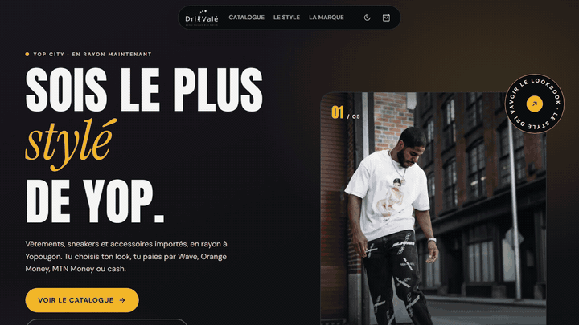
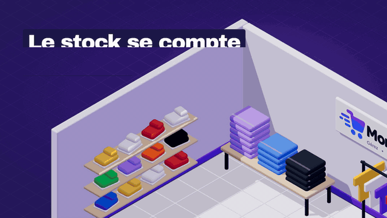

<!-- Bannière animée -->

<!-- Ligne qui s'écrit -->

  

<!-- Badges -->

  
  
  

  <a href="#version-française">🇫🇷 Français</a> &nbsp;·&nbsp; <a href="#english-version">🇬🇧 English</a>

---

<h2>🇫🇷 Version française</h2>

  

## ⭐ Projet phare

  

  

  

**Dri Valé** est une boutique streetwear à Yopougon, avec deux points de vente (Oasis et Toit Rouge). J'ai construit tout son outil :

- 🛍️ **Le site vitrine** : catalogue par rayon, lookbook avec les photos des clients, panier qui rédige la commande WhatsApp à la place du client.
- 📦 **La gestion** : stock par boutique, caisse, entrées et sorties, promotions, rapports du jour, activité de l'équipe.
- 💳 **Le paiement local** : Wave, Orange Money, MTN Money ou cash.

`Next.js` · `TypeScript` · `HeroUI` · `TanStack Query` · `Zustand` · `NestJS` · `Laravel` · `PostgreSQL`

### 🛒 Né de Dri Valé : Mon Djossi

  

  

L'outil de Dri Valé est devenu un produit ouvert à toutes les boutiques : **Mon Djossi**. La caisse marche hors ligne quand le réseau coupe, le stock se met à jour à chaque vente et le gérant reçoit son bilan le soir sur son téléphone. L'app s'adapte au métier : vêtements, friperie, restaurant, quincaillerie.

  

---

## 🛠️ Stack

**Langages et frameworks**

**Front, mobile et outils**

**Bases de données**

**Données avec Python**

  
  
  

| 🎛️ Interface et état | ✨ Animation | 🔐 API et sécurité | 📡 Temps réel |
|---|---|---|---|
| HeroUI · Radix UI · DaisyUI Zustand · TanStack Query / Table | Framer Motion · GSAP Three.js · Embla | JWT · Passport · CASL Swagger / OpenAPI | Socket.io WebSockets |

---

## 💼 Parcours

| | |
|---|---|
| 🟢 **LUNION-LAB** · Développeur Full-Stack 📍 Cocody, Abidjan · août 2025 → aujourd'hui | Plus de 9 applications livrées en production : ERP et finance pour Turbo Delivery, commande en ligne de Chicken-Nation, Catholikia, plateformes immobilières, gestion de flotte pour la SATE. Avant ce poste : 7 mois de formation et de stage Next.js / NestJS chez LUNION-LAB (janv. → juil. 2025). |
| 🔵 **SOTRA** · Développeur Web (stage) 📍 Vridi, Abidjan · août → nov. 2024 | Base de données conçue avec MERISE, application de gestion interne sous WinDev, requêtes SQL de reporting. Livrée en 4 mois et validée par la DSI. |

---

## 🌍 Projets en ligne

| Projet | Ce que c'est | Lien |
|---|---|---|
| ⭐ **Dri Valé** | Boutique streetwear : site vitrine, stock et caisse | [dri-vale.online](https://www.dri-vale.online) |
| 🛒 **Mon Djossi** | Caisse et stock pour les commerces ivoiriens | [mon-djossi.shop](https://mon-djossi.shop) |
| 🍗 **Chicken-Nation** | Menu et commande en ligne pour une chaîne de fast-food | [chicken-nation.com](https://www.chicken-nation.com/fr) |
| ⛪ **Catholikia** | Plateforme paroissiale, rôles membres, prêtres et admins | [catholikia.com](https://catholikia.com/fr) |
| 🛵 **Turbo ERP** | ERP de livraison : RH, logistique, finance | [admin-erp.turbodeliveryapp.com](https://admin-erp.turbodeliveryapp.com) |
| 🏢 **Sidi Immobilier** | Annonces avec recherche par zone et budget | [sidi.lunion-lab.com](https://sidi.lunion-lab.com/fr) |
| 🏡 **Luxury Home Abidjan** | Immobilier haut de gamme | [luxuryhomeabidjan.com](https://luxuryhomeabidjan.com) |
| 📦 **Stock Pro** | Gestion de stock avec alertes de seuil | [stock-pro](https://stock-pro-six.vercel.app/stock) |

<strong>📁 Autres projets</strong>

 

| Projet | Type | Stack |
|---|---|---|
| 🛍️ **Djene Shop** | E-commerce | Next.js · Zustand · Framer Motion · GSAP · NestJS |
| 📚 **Biblio UPB** | Bibliothèque universitaire, 3 rôles | Next.js · TanStack Table · NestJS · Prisma |
| 🎫 **Basit Ticket** | Système de tickets | Next.js · NestJS · TypeORM · PostgreSQL |
| 🏫 **Gestion École** | ERP scolaire | Next.js · React Hook Form · Zod · Recharts |
| 🔧 **Maintenance Pro** | Flotte et interventions (SATE) | Next.js · HeroUI · NestJS · Prisma |
| 🎓 **Lunion Educ App** | Application mobile éducative | Flutter · Dart |
| 🌍 **H2C Africa** | Site institutionnel | Vite · React · TipTap · DaisyUI |
| 🔒 **Lunion Secu** | API de sécurité en temps réel | NestJS · JWT · Socket.io · Passport |
| 🏨 **Hotel** | API de gestion hôtelière | NestJS · Prisma · PostgreSQL |
| 🌿 **Site Ephrata** | Site vitrine | Next.js · GSAP · Embla Carousel |
| ⚽ **OSA FC** | Site officiel d'un club de football | Next.js · NestJS · PostgreSQL |

---

## 🎓 Formation et certifications

| 🎓 Formation | 📜 Certifications |
|---|---|
| **Licence MIAGE** · Université Polytechnique de Bingerville · 2021 → 2024 **Baccalauréat série D** · Lycée Moderne 1 Abobo · 2021 | **Full-Stack JS · Next.js / NestJS** · LUNION-LAB · 2025 **Full-Stack JS · MERN** · GOMYCODE · 2023 → 2024 **Python pour l'analyse de données** · GOMYCODE · 2022 |

---

<h2>🇬🇧 English version</h2>

  

## ⭐ Featured project

  

  

  

**Dri Valé** is a streetwear store in Yopougon, Abidjan, with two shops (Oasis and Toit Rouge). I built its whole system:

- 🛍️ **Storefront**: catalogue by category, a lookbook of real customers, a cart that writes the WhatsApp order for the customer.
- 📦 **Back office**: stock per shop, point of sale, stock in and out, promotions, daily reports, team activity.
- 💳 **Local payments**: Wave, Orange Money, MTN Money or cash.

`Next.js` · `TypeScript` · `HeroUI` · `TanStack Query` · `Zustand` · `NestJS` · `Laravel` · `PostgreSQL`

### 🛒 Born from Dri Valé: Mon Djossi

  

  

The Dri Valé system became a product for every shop: **Mon Djossi**. The till keeps selling when the network drops, stock updates with each sale, and the owner gets the day's report on their phone every evening. It adapts to the trade: clothing, thrift, restaurants, hardware.

  

---

## 🛠️ Stack

**Languages and frameworks**

**Front end, mobile and tools**

**Databases**

**Data with Python**

  
  
  

| 🎛️ UI and state | ✨ Animation | 🔐 API and security | 📡 Real time |
|---|---|---|---|
| HeroUI · Radix UI · DaisyUI Zustand · TanStack Query / Table | Framer Motion · GSAP Three.js · Embla | JWT · Passport · CASL Swagger / OpenAPI | Socket.io WebSockets |

---

## 💼 Experience

| | |
|---|---|
| 🟢 **LUNION-LAB** · Full-Stack Developer 📍 Cocody, Abidjan · Aug 2025 → present | 9+ applications shipped to production: ERP and finance for Turbo Delivery, online ordering for Chicken-Nation, Catholikia, real estate platforms, fleet management for SATE. Before that: 7 months of Next.js / NestJS training and internship at LUNION-LAB (Jan → Jul 2025). |
| 🔵 **SOTRA** · Web Developer (intern) 📍 Vridi, Abidjan · Aug → Nov 2024 | Database designed with MERISE, internal management app in WinDev, SQL reporting queries. Delivered in 4 months and approved by the IT department. |

---

## 🌍 Live projects

| Project | What it is | Link |
|---|---|---|
| ⭐ **Dri Valé** | Streetwear store: storefront, stock and point of sale | [dri-vale.online](https://www.dri-vale.online) |
| 🛒 **Mon Djossi** | Point of sale and inventory for Ivorian shops | [mon-djossi.shop](https://mon-djossi.shop) |
| 🍗 **Chicken-Nation** | Menu and online ordering for a fast-food chain | [chicken-nation.com](https://www.chicken-nation.com/fr) |
| ⛪ **Catholikia** | Parish platform with member, priest and admin roles | [catholikia.com](https://catholikia.com/fr) |
| 🛵 **Turbo ERP** | Delivery ERP: HR, logistics, finance | [admin-erp.turbodeliveryapp.com](https://admin-erp.turbodeliveryapp.com) |
| 🏢 **Sidi Immobilier** | Property listings with search by area and budget | [sidi.lunion-lab.com](https://sidi.lunion-lab.com/fr) |
| 🏡 **Luxury Home Abidjan** | High-end real estate | [luxuryhomeabidjan.com](https://luxuryhomeabidjan.com) |
| 📦 **Stock Pro** | Inventory management with threshold alerts | [stock-pro](https://stock-pro-six.vercel.app/stock) |

<strong>📁 Other projects</strong>

 

| Project | Type | Stack |
|---|---|---|
| 🛍️ **Djene Shop** | E-commerce | Next.js · Zustand · Framer Motion · GSAP · NestJS |
| 📚 **Biblio UPB** | University library, 3 roles | Next.js · TanStack Table · NestJS · Prisma |
| 🎫 **Basit Ticket** | Ticketing system | Next.js · NestJS · TypeORM · PostgreSQL |
| 🏫 **School Management** | School ERP | Next.js · React Hook Form · Zod · Recharts |
| 🔧 **Maintenance Pro** | Fleet and service tracking (SATE) | Next.js · HeroUI · NestJS · Prisma |
| 🎓 **Lunion Educ App** | Educational mobile app | Flutter · Dart |
| 🌍 **H2C Africa** | Institutional website | Vite · React · TipTap · DaisyUI |
| 🔒 **Lunion Secu** | Real-time security API | NestJS · JWT · Socket.io · Passport |
| 🏨 **Hotel** | Hotel management API | NestJS · Prisma · PostgreSQL |
| 🌿 **Site Ephrata** | Showcase website | Next.js · GSAP · Embla Carousel |
| ⚽ **OSA FC** | Official website of a football club | Next.js · NestJS · PostgreSQL |

---

## 🎓 Education and certifications

| 🎓 Education | 📜 Certifications |
|---|---|
| **Bachelor's degree, MIAGE** (IT for business management) · Polytechnic University of Bingerville · 2021 → 2024 **Baccalaureate, science track** · Lycée Moderne 1 Abobo · 2021 | **Full-Stack JS · Next.js / NestJS** · LUNION-LAB · 2025 **Full-Stack JS · MERN** · GOMYCODE · 2023 → 2024 **Python for data analysis** · GOMYCODE · 2022 |

---

## 📊 Activité GitHub · GitHub activity

  <picture>
    <source media="(prefers-color-scheme: dark)" srcset="https://raw.githubusercontent.com/Niortien/Niortien/output/github-snake-dark.svg" />
    <source media="(prefers-color-scheme: light)" srcset="https://raw.githubusercontent.com/Niortien/Niortien/output/github-snake.svg" />
    
  </picture>

  
  

  

---

## 📫 Contact

  

  
  
  
  

<!-- Vague du bas -->

